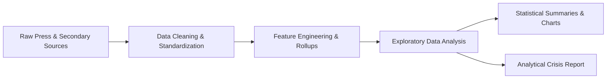

# 🔍 Paper Leak Analysis in India (2004–2026)

[](https://www.python.org/)
[](https://jupyter.org/)
[](https://pandas.pydata.org/)
[](https://seaborn.pydata.org/)
[](https://opensource.org/licenses/MIT)
[](https://github.com/Vaibhavs7707)

> **A forensic data analysis and statistical investigation into 110 documented high-stakes examination breaches across India (2004–2026), evaluating systemic vulnerabilities, jurisdictional breakdowns, aspirant impacts, and the law enforcement accountability gap.**

---

## 📌 Executive Summary

Every year, tens of millions of Indian youth compete for limited seats in prestigious educational institutions and public sector jobs. The integrity of competitive examinations (such as **NEET-UG, UGC-NET, State PSCs, Police Constabulary, and SSC**) represents the cornerstone of socio-economic mobility.

However, repeated question paper leaks, digital exfiltration, solver gangs, and distribution breaches have triggered widespread public distrust, litigation, and student distress.

This project delivers an end-to-end **Exploratory Data Analysis (EDA)** and structural forensic examination of **110 verified and publicly reported paper leak incidents** occurring between **April 2004 and 2026**. Using Python data science workflows, this study investigates:
1. **Temporal Trends & Trajectories:** How breach frequencies have surged across successive decades and political administrations.
2. **Institutional & Sectoral Vulnerability:** Which sectors (Healthcare/Medical, Government Recruitment, Police, Teacher Eligibility) are disproportionately exploited.
3. **Geographic & Jurisdictional Distribution:** Comparison of state-level examination boards versus centralized examination bodies.
4. **The Accountability Void:** The stark structural divergence between initial police arrests and final judicial convictions.

---

## 🎯 Key Strategic Insights

| Dimension | Key Finding | Strategic Implication |
| :--- | :--- | :--- |
| **Temporal Surge** | **>60%** of all recorded incidents occurred after 2019, peaking during the 2021–2024 recovery cycles. | Accelerated digitalization and centralized testing have concentrated targets without matching physical/cyber perimeter security. |
| **Jurisdictional Divide** | **80.0%** of incidents originated under State authorities (88 of 110), compared to **20.0%** under Central bodies (22 of 110). | State-level testing agencies suffer from fragmented oversight, outsourced logistics, and vulnerable local printing/custody hubs. |
| **Sector Concentration** | **Recruitment (Civil Services/SSC)** and **Medical (NEET/AIPMT)** account for over **55%** of high-impact breaches. | High candidate volume and life-altering career outcomes create lucrative financial incentives for organized solver syndicates. |
| **Enforcement Deficit** | While arrests were documented in **57.3%** of incidents, confirmed convictions were reported in only **9.1%**. | Highlights protracted litigation, evidentiary decay, and institutional attrition in convicting kingpins behind paper-leak syndicates. |
| **Aspirant Fallout** | Over **40 million candidates** have been impacted cumulatively through exam cancellations, re-tests, and delays. | Multi-year delays inflict severe mental stress and financial burdens on candidates from lower-income backgrounds. |

---

## 🏗️ Technical Architecture & Pipeline



1. **Data Ingestion & Schema Sanitization:**
   - Standardized disparate date formats into ISO standard datetime objects.
   - Cleaned messy geographic locations into normalized state boundaries.
   - Standardized exam authority nomenclature (e.g., CBSE, NTA, BSSC, UPPSC, TSPSC).
2. **Feature Engineering & Categorization:**
   - **8-Sector Taxonomy:** Grouped varied test titles into 8 canonical sectors (*Medical / Healthcare*, *Engineering / Technical*, *Civil Services / Administration*, *Police & Armed Forces Recruitment*, *Teaching Eligibility*, *School Board Exits*, *General Recruitment*, *Other*), reducing the ambiguous "Other" classification from 25.5% down to 5.5%.
   - **Administrative Split:** Classified testing bodies into `State` vs. `Central` tiers.
   - **Action Categorization:** Consolidated diverse administrative responses into 5 standardized categories (*Exam Cancelled / Retest*, *Arrests / FIR / Probe*, *Disciplinary Action*, *Denied / Under Review*, *No Action*).
3. **Forensic Analysis & Verification:**
   - Source reliability grading (High/Medium confidence corroboration).
   - Analysis of repeat offenders among testing authorities.
   - Quantification of candidate impact and judicial resolution metrics.

---

## 📂 Repository Structure

```
Paper-Leak-Analysis-in-India-2004-2026/
├── .gitignore                          # Standard Python / Jupyter exclusion rules
├── requirements.txt                    # Pinned Python package dependencies
├── paper_leak_data_cleaned.csv         # Structured dataset (110 incidents, 24 features)
├── paper_leak_analysisV3.ipynb         # Full reproducible Jupyter analysis notebook
├── Paper_Leak_Crisis_Reportpdf.pdf     # In-depth executive research publication
└── README.md                           # Recruiter-ready technical documentation
```

---

## 📊 Data Dictionary

The cleaned dataset (`paper_leak_data_cleaned.csv`) includes **24 curated features** across 110 documented incidents:

| Column Name | Data Type | Coverage | Description |
| :--- | :--- | :--- | :--- |
| `incident_id` | String | 100% | Unique alphanumeric incident identifier (`PL-0001` .. `PL-0110`) |
| `date` | Date (YYYY-MM-DD) | 100% | Validated incident date |
| `year` | Integer | 100% | Extracted calendar year of breach |
| `era` | String | 100% | Political administration era (`UPA (2004–May 2014)` vs `NDA (May 2014–2026)`) |
| `exam_name` | String | 100% | Verbatim name of the examination as reported |
| `standardized_exam_name`| String | 100% | Canonical nomenclature unifying multi-year equivalents (e.g., NEET / AIPMT) |
| `exam_category` | String | 100% | Engineered 8-sector taxonomy |
| `conducting_body` | String | 100% | Normalized canonical testing authority (e.g., NTA, CBSE, UPPSC) |
| `body_type` | String | 100% | Administrative classification (`State` vs. `Central`) |
| `area` | String | 100% | Geographic incident locus or state |
| `leak_status` | String | 100% | Official breach status (`Confirmed`, `Alleged`, `Denied`) |
| `action_taken` | String | 100% | Verbatim administrative/legal action reported |
| `action_summary` | String | 100% | 5-bucket engineered response rollup |
| `arrests` | Float | 57.3% | Documented count of arrested conspirators / solver gang members |
| `convictions` | Float | 9.1% | Verified count of individuals judicially convicted |
| `aspirants_affected` | Float | 40.0% | Official or estimated number of affected registered candidates |
| `linked_deaths` | Float | 3.6% | Press-documented fatalities linked to the scam/investigation |
| `confidence` | String | 100% | Source verification grade (`High`, `Medium`) based on corroboration |
| `source_name` | String | 100% | Reporting news media or official gazette source |
| `source_url` | String | 100% | Archival URL reference for evidentiary auditing |

---

## 🛠️ Tech Stack & Dependencies

- **Programming Language:** Python 3.10+
- **Data Manipulation & Analysis:** [Pandas](https://pandas.pydata.org/), [NumPy](https://numpy.org/)
- **Statistical Visualization:** [Matplotlib](https://matplotlib.org/), [Seaborn](https://seaborn.pydata.org/)
- **Interactive Development:** [JupyterLab / Jupyter Notebook](https://jupyter.org/)
- **Version Control:** Git & GitHub

---

## 🚀 Setup & Execution Guide

### 1. Prerequisites
Ensure you have **Python 3.10+** and `git` installed on your local machine:
```bash
python3 --version
git --version
```

### 2. Clone the Repository
```bash
git clone https://github.com/Vaibhavs7707/Paper-Leak-Analysis-in-India-2004-2026.git
cd Paper-Leak-Analysis-in-India-2004-2026
```

### 3. Create and Activate a Virtual Environment
```bash
# macOS / Linux
python3 -m venv venv
source venv/bin/activate

# Windows (PowerShell)
python -m venv venv
.\venv\Scripts\Activate.ps1
```

### 4. Install Dependencies
```bash
pip install --upgrade pip
pip install -r requirements.txt
```

### 5. Launch Jupyter Notebook
```bash
jupyter lab
# or
jupyter notebook
```
Open [`paper_leak_analysisV3.ipynb`](paper_leak_analysisV3.ipynb) and select **Run All Cells** to reproduce every table, metric, and visualization from scratch.

---

## 💡 Policy & Governance Recommendations

Based on empirical data from this analysis, mitigating future paper leaks requires systemic reforms:
1. **Chain-of-Custody Digital Ledger:** Cryptographic tracing and tamper-evident physical distribution for physical question papers.
2. **Standardized State Testing Protocols:** Modernizing state examination boards to adhere to stringent ISO/IEC 27001 data-security benchmarks.
3. **Fast-Track Anti-Leak Tribunals:** Establishing dedicated judicial fast-track courts under the *Public Examinations (Prevention of Unfair Means) Act, 2024* to bridge the 57.3% arrest vs. 9.1% conviction gap.
4. **Solver Syndicate Asset Forfeiture:** Enhancing economic deterrence against organized cheating mafias through financial and cyber forensic probes.

---

## 👨‍💻 Author & Attribution

**Vaibhav Srivastava**
- **GitHub:** [@Vaibhavs7707](https://github.com/Vaibhavs7707)
- **Email:** [Vaibhavs3912@gmail.com](mailto:Vaibhavs3912@gmail.com)

---

## 📄 License

This repository is licensed under the [MIT License](https://opensource.org/licenses/MIT). You are free to utilize, modify, and distribute this research with appropriate attribution.
